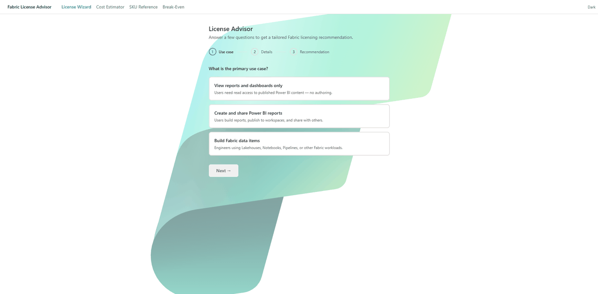

# FabricApp_FabricLicenseAdvisor

Interactive Fabric App guiding Fabric admins, consultants, and BI managers through Microsoft Fabric licensing decisions.

**Live:** https://brief-fawn-30a395c0ef-northeurope.webapp.fabricapps.net

## Gallery

Submitted to the [Microsoft Fabric Apps Gallery](https://community.fabric.microsoft.com/discussions/pbi_fabricappsgallery/fabric-license-advisor/5428394).

## Screens

| Screen | Route | Description |
|--------|-------|-------------|
| License Wizard | / | 3-step decision wizard — recommends Fabric capacity, Pro, or PPU |
| Cost Estimator | /estimate | PAYG vs Reserved side-by-side calculator |
| Break-Even | /breakeven | Crossover point where Fabric capacity beats per-user licensing; org-size slider |
| SKU Reference | /skus | Full SKU table with CUs and pricing, live from semantic model |

## Stack

- **Data:** Lakehouse `lh_pricing` (pricing_sku, pricing_user_licenses, pricing_storage) in `ws_FabricLicenseAdvisor_Dev`
- **Semantic model:** `sm_FabricLicenseAdvisor` — DirectLake, DAX queries via Rayfin connector
- **Framework:** Rayfin SDK / CLI (`@microsoft/rayfin-cli@1.36.0-alpha`)
- **Auth:** Fabric SSO (Entra ID)
